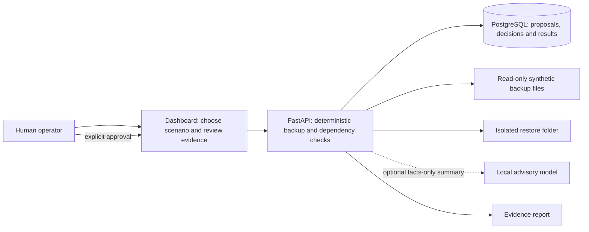

# ResilienceGuard Architecture

## Plain-language view

An operator picks a disruption, such as losing the main data center. ResilienceGuard checks the synthetic service list, backup files, and service requirements. It shows which copies can be considered, which services have blockers, and what should be tested first. If an operator approves a proposal, the system copies one registered sample file into a separate test folder and checks that copy.

The dashboard and API run locally. The source fixtures are read-only. The restore folder is separate. The optional language model can explain supplied facts, but it cannot make the rules, approve an action, or run a restore.

## Technical view

1. **Operator UI:** React 19 and TypeScript display the selected scenario, backup facts, service dependencies, recovery order, approval controls, actual restore results, and report downloads.
2. **Assurance API:** FastAPI and Pydantic load the synthetic catalog. Python checks file existence, age, SHA-256, scenario reachability, and trust status. NetworkX follows the service dependency graph and finds blocked services.
3. **Workflow persistence:** SQLAlchemy saves proposed actions, single-use human decisions, restore results, and audit events in PostgreSQL 18 under Docker Compose. SQLite supports a single-user host run.
4. **Evidence and isolated test:** The restore runner accepts only a human-approved action and registered synthetic file. It writes beneath an action-specific directory, compares source and destination SHA-256, and checks the JSON fixture structure.
5. **Optional assistant:** Ollama/Qwen3 receives a bounded evidence summary. It has no tool access. Responses are advisory, evidence IDs are checked, and the rule-based answer is used if the model is unavailable or invalid.

## Example: a hospital service after data-center loss

The hospital application needs both a clinical database and an identity service. Identity needs the directory store. The demo finds a verified database copy in the West vault, but the copy is one hour older than the configured two-hour recovery-point target. It also finds no directory-store backup record. The database can be considered for an isolated test; the hospital application remains blocked by the missing identity dependency.

This is an assessment result, not proof that the application has been restored. A matching SHA-256 fingerprint does not prove malware cleanliness. See [AUDIENCE_GUIDE.md](AUDIENCE_GUIDE.md) for the status glossary and [AI_AGENT_GUIDE.md](AI_AGENT_GUIDE.md) for safe agent usage.

## Control boundaries

- No production connector, credential, backup-control API, shell command runner, or destructive AI tool is included.
- A hash match means the file matches the saved reference; it is not a malware or provenance verdict.
- “Ready to test” means the deterministic eligibility checks passed; only an actual approved copy creates a restore result.
- The restore check validates synthetic JSON. It does not start a database server or hospital application.
- Malware scanning, identity/role separation, approval quorum, immutable audit storage, and production hardening remain out of scope.
